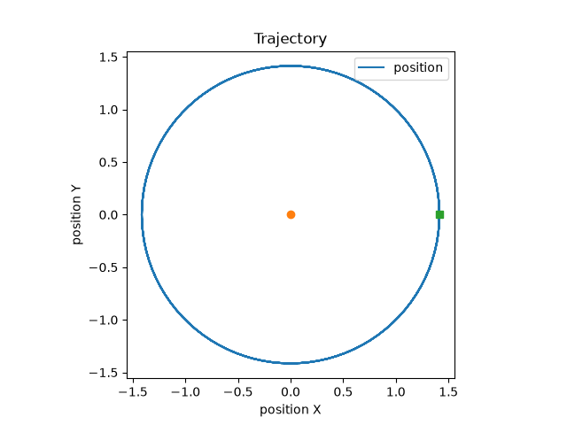
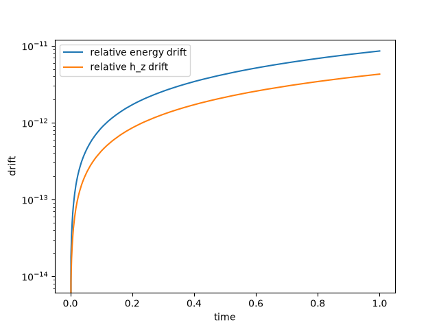

# Orbital Simulator
This is a python project which i built in order to understand how different numerical methods could be used to simulate orbits while checking how accurate they are. 

## Numerical Methods
This simualator currently make use of four methods:
- Euler
- Symplectics
- Velocity Verlet
- Runge-Kutta 4 (RK4)
These methods calculate the object's position and velocity at each step.
I will be comparing how the results differ, particularly in terms of their energy conversion and orbital stability.

## How to Run:
To run the simulator, open the terminal in the folder and enter - 
```bash
python -m orbitsim run configs/circular.toml
```
To compare the results for different step sizes, run
``` bash
python -m orbitsim sweep configs/circular.toml
```
The results and plots are saved within the `runs/` folder

## Results

### Orbital Trajectory


This plot shows the path followed by the orbiting object during the simulation

### Step-Size Comparison


This plot shows the comparison between the changes in numerical drift when the a different step size is used. 

## Acceptance Tests
Made use of pytest in order to check wether or not the simulator is behaving as expected. The tests cover the accuracy of the conservation of energy, orbit, and the angular momentum, including the differences between the four numerical methods

The criteriaare as follows:
- **AC-1** Velocity Verlet keeps the relative radius error below \(10^{-3}\) over 10 orbits
- **AC-2** RK4 keeps relative energy and angular momentum drift below \(10^{-6}\) over 10 obrits
- **AC-3** Symplectic Euler and Velocity verlet kep the relative angular momentum drift below \(10^{-12}\) after 10 orbits
- **AC-4** The maximum energy error for the symplectic methods over 100 orbits stay below twice the maximum error over 10 orbits
- **AC-5** Euler's energy icnrases at every step, and its final orbital radius exceeds its initial radius.

To run the acceptance tests:
```bash
pytest tests/test_acceptance.py -v
```
To run all tests:
```bash
pytest -v
```

## Limitations
The simulator currently models motion in two dimensions around a fixed central body making use of Newtonian Gravity
It uses a fixed timestep and doesn't simulate multiple intereacting bodies, a moving central body, atmospheric drag, thrust or relativistic effects. It also doesn't include 3D visualisations or adaptive timesteps. 